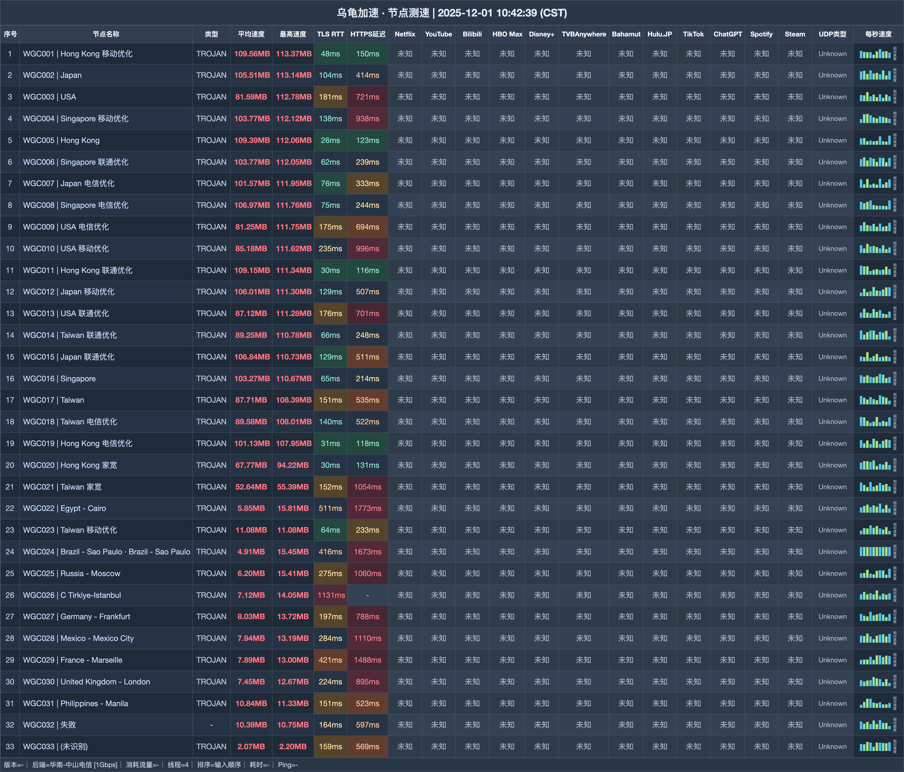

# 乌龟加速机场测评｜200G 月档 18 元，家庭设备不限（2026-11-02 更新）

> **先看结论：家庭月付从 200G 到 1200G，价格与限速逐档上升，同时要求使用官方专属客户端。**
>
> 👉 **[进入注册页](https://wuguijiasu.com/#/login?code=dd6NtGYo)** · 先用 18 元 Mini 检查客户端和线路；多人视频需求再看 38 元 Pro。

## 哪些人更匹配

- 希望 18 元获得 200G 起步流量的人
- 家庭设备较多，需要不限终端的人
- 接受使用官方专属客户端的人

## 哪些情况建议跳过

- 只愿使用其他客户端的人
- 完全用不到 EMBY 与家庭共享的人

| 快速判断 | 当前信息 |
|---|---|
| 入门月档 | 200G / 18 元 |
| 月流量跨度 | 200G—1200G |
| 速度上限 | 300—1000Mbps |
| 设备规则 | 月档不限；限家庭共享 |
| 线路类型 | IEPL |
| 客户端要求 | 官方专属客户端 |

**站点定位**：乌龟加速（wugui / wuguijiasu）从 18 元 200G 起，采用 IEPL，并要求通过官方专属客户端连接。

## 全部套餐怎么排

| 套餐 | 价格 | 流量 | 设备 | 限速 | 说明 |
|---|---:|---:|---:|---:|---|
| Mini-包月200G | ¥18/月付 | 200G · 每月 | 不限 | 300M | 可购买重置包；家庭共享；赠送EMBY |
| Pro-包月500G | ¥38/月付 | 500G · 每月 | 不限 | 500M | 可购买重置包；家庭共享；赠送EMBY |
| Max-包月800G | ¥58/月付 | 800G · 每月 | 不限 | 800M | 可购买重置包；家庭共享；赠送EMBY |
| Star-包月1200G | ¥78/月付 | 1200G · 每月 | 不限 | 1000M | 可购买重置包；家庭共享；赠送EMBY |
| Max-不限时3000G | ¥358/一次性 | 3000G · 用完为止 | 不限 | 1000M | 可购买重置包；家庭共享 |
| Star-不限时6000G | ¥658/一次性 | 容量待确认 · 用完为止 | 不限 | 1000M | 标题/括注6000G/6000GB；详情字段658.00GB，与¥658价格疑似串位但未证实 |

**购买前提醒：**购买前先确认官方客户端的系统支持与下载来源。套餐不退款。6000G 档的标题、括注写 6000G / 6000GB，详情字段却写 658.00GB；价格 658 元保留，容量不用于确定推荐。

## 节点测速图

图表汇总 33 行下载与延迟结果，测试端为 华南-中山电信 [1Gbps]，运行 4 线程。 图中日期为 **2025-12-01**，完整表格如下：

## 选择顺序

1. 先用 18 元 Mini：200G、300Mbps，同时验证专属客户端是否适配。
2. 持续需要 500G 时再选 38 元 Pro，限速为 500Mbps。
3. 大流量可比较 358 元 3000G 不限时包；6000G 档在容量记录明确前不作主推。

## 注册入口

👉 **[打开注册页面](https://wuguijiasu.com/#/login?code=dd6NtGYo)** · 先用 18 元 Mini 检查客户端和线路；多人视频需求再看 38 元 Pro。

*本文含推广链接；通过该入口注册或购买，本站可能获得佣金。*

## 本文更新

- **2026-10-31**：重新编排购买建议与全部套餐，共保留 5 个套餐/展示项。
- **2025-12-01**：节点测速图所示日期。

---
*套餐价格、节点与活动可能调整，付款前请以购买页当时显示为准。*

展开相关搜索词

搜索组合：乌龟加速、wugui、wuguijiasu、乌龟机场、机场测评2026、IEPL机场、家庭机场、代理订阅、乌龟加速入口、乌龟加速注册、乌龟加速测速

